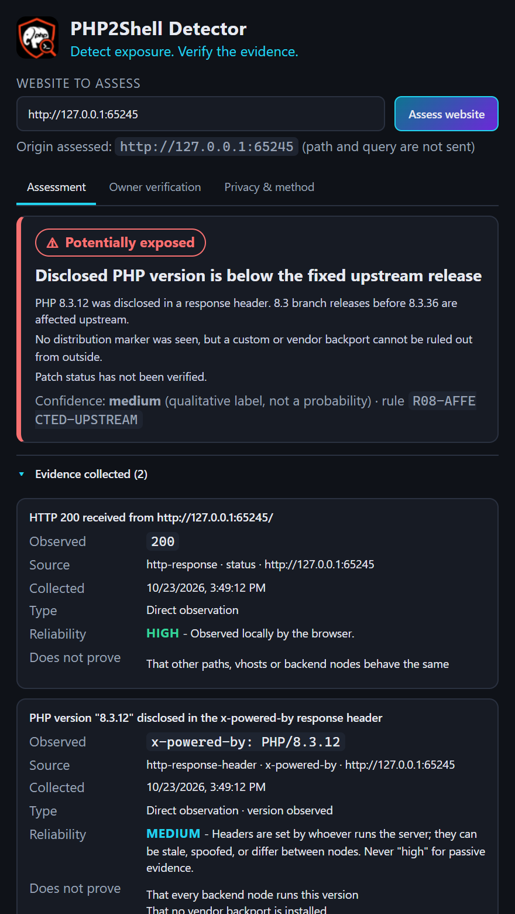
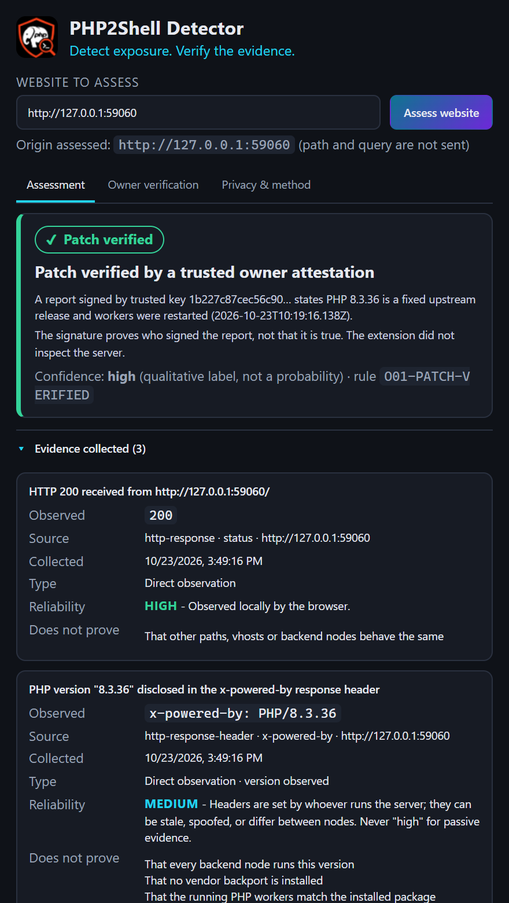

# PHP2Shell Detector

> **Detect exposure. Verify the evidence.**

A privacy-first Chrome extension (Manifest V3) that assesses a website for **PHP2Shell** exposure indicators - [CVE-2026-109618](https://github.com/php/php-src/security/advisories/GHSA-w8hw-w9fx-j79w) and [CVE-2026-109619](https://github.com/php/php-src/security/advisories/GHSA-6wmf-4rv5-p3rp) - and shows **what the evidence is, where it came from, how reliable it is, and what it cannot prove**.

It is a *defensive, passive* tool: one benign `GET /` to a site you choose, headers only. It never sends exploit payloads, never tries to execute code, never crawls, never phones home.

| | |
|---|---|
|  |  |

More screenshots (all captured from the real built extension in Chromium): [`docs/screenshots/`](docs/screenshots).

## What it does that a header→badge checker doesn't

* **Six evidence-based states**, never "Vulnerable / Safe": Potentially exposed · Exposure indicators detected · Mitigation detected · Patch verified · Inconclusive · No indicators detected.
* **Evidence cards**: observed value, source, timestamp, direct-vs-inferred, reliability + reason, *does not prove*.
* **Backport-aware**: a distro marker (`(Ubuntu)`, `~deb12`, `.el9`…) turns "affected version" into "a vendor backport may apply". Unsupported branches, CDN/proxy, conflicting headers, stale advisory data and redirects each change the verdict transparently (rule IDs shown).
* **Owner verification**: import a schema-validated report (optionally Ed25519-signed with the companion CLI). Only a signature from a key *you* trust, with a restart confirmation and a consistent version, reaches **Patch verified**. Self-reported data is always labelled.
* **Redacted export** (JSON + Markdown): no cookies, credentials, auth headers, header dumps, URL paths or bodies.
* **Source-traceable advisory data** with check dates, per-claim provenance, a recorded source conflict (php.net vs Google Cloud on ≤ 8.1 backports) and a staleness clock.

## Install (unpacked) - Windows / macOS / Linux

Requires Node.js ≥ 20 and Chrome ≥ 137 (WebCrypto Ed25519 for signed reports).

```bash
npm ci
npm run build          # typecheck + production build into dist/ + bundle audit
```

Then in Chrome: `chrome://extensions` → enable **Developer mode** → **Load unpacked** → choose the `dist/` folder.

## Use

1. Open the popup on a site (the URL is prefilled from the active tab) or type any `http(s)` URL.
2. **Assess website** → exactly one request to that site. There are no per-site prompts: http(s) access is granted when you install (see the permission note in `docs/PRIVACY.md`).
3. Read the state, rationale, evidence, CVEs, unknowns and next steps. Export if needed.
4. Site owner? **Owner verification** tab → follow the CLI steps → import the report.

Use only on systems you own or are authorised to assess.

## Develop and test

```bash
npm run typecheck
npm test                    # unit + integration (vitest; 100 tests)
npm run build               # release bundle + audit (scripts/check-dist.mjs)
npm run test:e2e            # real Chrome + built extension (see below)
npm run screenshots         # regenerate docs/screenshots and store/screenshots from the real UI
npm run package             # build + audit + php2shell-detector-<version>.zip for the Web Store
```

### End-to-end tests

`npm run test:e2e` builds `dist-e2e/` (the same code as release; the **only** differences are a throwaway manifest `key` so the test can compute the extension ID, a test name, and loopback-only `host_permissions`) and drives the popup with Playwright against **synthetic loopback servers** - never public targets.

```bash
npx playwright install chromium        # once
# optional: use a specific browser binary
export P2S_CHROME="/path/to/chrome"    # PowerShell: $env:P2S_CHROME="C:\path\to\chrome.exe"
npm run test:e2e
```

### Companion CLI for administrators

```bash
node tools/php2shell-attest.mjs keygen --out attest-key.json
node tools/php2shell-attest.mjs report --origin https://example.com \
  --patch-status fixed-upstream --workers-restarted --package-source upstream-source \
  --key attest-key.json --out report.json
```

See [`docs/OWNER_VERIFICATION.md`](docs/OWNER_VERIFICATION.md).

## Repository map

| Path | Purpose |
|---|---|
| `extension/static/` | `manifest.json` (MV3) and icons, copied into `dist/` |
| `src/popup/` | React UI (Radix Tabs/Collapsible for accessible primitives) |
| `src/scanner/` | URL normalisation, the single request, header fingerprints |
| `src/advisories/` | zod-validated advisory dataset (`data/php2shell.json`), version classification - **separate from the scanner** |
| `src/assessment/` | rules engine, guidance |
| `src/verification/` | owner-report schema, canonical JSON, Ed25519, evaluation |
| `src/reports/` | JSON + Markdown export |
| `src/privacy/` | header allowlist and redaction |
| `tests/` | `unit/`, `integration/` (real local HTTP servers), `e2e/` (Playwright) |
| `tools/php2shell-attest.mjs` | admin CLI (keygen / report / sign) |
| `docs/` | research, methodology, threat model, privacy, release checklist, roadmap |

## Documentation

* [Research and gap analysis](docs/RESEARCH.md) · [Methodology & limitations](docs/METHODOLOGY.md) · [Threat model](docs/THREAT_MODEL.md)
* [Privacy & permissions](docs/PRIVACY.md) · [Owner verification](docs/OWNER_VERIFICATION.md)
* [Chrome Web Store checklist](docs/RELEASE.md) · [Roadmap](docs/ROADMAP.md)

## Verification status (what was and wasn't actually run)

Run and passing when this was written (2026-10-23, Windows 11, Node 24, Chromium 1243 via Playwright):

* `tsc --noEmit` (strict), `vitest run` (100 tests), `npm run build` incl. bundle audit, `playwright test` (7 tests in real Chromium loading `dist-e2e`), screenshot capture.

**Not** verified automatically - needs a human before publishing (see `docs/RELEASE.md` manual checklist):

* The real toolbar-popup flow (`activeTab` URL prefill, Chrome's install-time permission warning): automation loads the extension but cannot click the toolbar icon.
* Behaviour against real PHP deployments (mod_php/FPM/distro packages); all fixtures are synthetic.
* Whether the vendor/distro backport status for any specific package is fixed - the dataset intentionally contains none.
* Chrome Web Store submission, hosted privacy policy, listing assets.
* The confidence label is qualitative and uncalibrated.

Advisory data was checked on 2026-10-23 and goes stale after 30 days; re-verify before each release.

## Licence

MIT. See [LICENSE](LICENSE). The logo in `logo/` is a separate asset; see the branding note in docs/RELEASE.md before reusing it.
